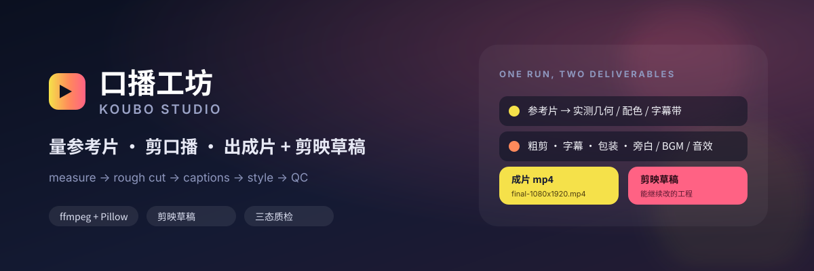

<div align="center">



# 口播工坊 · Koubo Studio

**把一条真人口播，剪成有风格、能交付、还能继续改的成片。**

量参考片风格 · 自动粗剪 · **剪映草稿为主** · mp4 预览 · 三态质检

[](LICENSE)
[](https://www.python.org/)
[](docs/install.md)
[](https://github.com/redbin1024/koubo-studio/actions/workflows/ci.yml)
[](CONTRIBUTING.md)

[一键安装](#一键安装) · [全自动](#全自动成片) · [手动流程](#手动流程可选) · [功能](#它到底能做什么) · [文档](#文档地图) · [限制](#先把丑话说在前面)

</div>

---

## 为什么是它

大多数「AI 剪辑」停在 **转写 + 切静音**。真到交付前，你还得自己量参考片、排镜头、配字幕、做信息卡、调音量、出剪映草稿、逐项检查。

口播工坊把这些串成一条**可审核的流水线**：

- **先量，再抄。** 参考片的卡片几何、强调色、字幕带、画中画位置会被量成数值，不是靠肉眼猜。
- **一条命令全自动。** `koubo auto` 从原始素材直接出可继续编辑的剪映草稿 + mp4 预览；本地规则打底，DeepSeek 只做可校验的导演建议，失败自动回退。
- **剪映草稿是主交付。** 主轨逐镜头、字幕/人声/音效/BGM 分轨；mp4 是压平的预览副本。转场、滤镜、关键帧、蒙版这些只在剪映里做。
- **缺席不等于通过。** 质检有三态：`pass` / `fail` / `unchecked`。判不了的项必须写清原因，不能从报告里消失。
- **Agent-native。** 仓库自带 [SKILL.md](SKILL.md)，Codex / Claude Code 等 Agent 可以直接按这份手册执行。

---

## 一键安装

```bash
curl -fsSL https://raw.githubusercontent.com/redbin1024/koubo-studio/main/install.sh | bash
```

装完先跑：

```bash
koubo doctor
```

安装器会做这些事：

| 做什么 | 说明 |
| --- | --- |
| 拉代码 | 默认装到 `~/.agents/skills/koubo-studio` |
| 建 venv | `.venv` 内安装 `numpy` / `Pillow`，不污染系统 Python |
| 装字体 | 下载 Noto Sans CJK SC Black 到安装目录 `fonts/`，不动系统字体 |
| 装 capcut-cli | 有 Node ≥ 18 时装到安装目录 `vendor/`，不污染全局 npm |
| 装旁白依赖 | `edge-tts`（跨平台，需联网） |
| 装 ASR | `faster-whisper`（默认装；`--minimal` / `--no-whisper` 可跳过） |
| 建软链接 | `~/.local/bin/koubo`，以及 Codex / Claude Code / Agents 的 skill 目录 |
| 环境自检 | 自动跑一遍 `koubo doctor` |

常用选项：

```bash
# 全量：额外装系统依赖与 Node（ASR 默认已装）
curl -fsSL https://raw.githubusercontent.com/redbin1024/koubo-studio/main/install.sh | bash -s -- --full

# 最小：只装 Python 核心（不含 ASR / 字体 / capcut / 旁白）
curl -fsSL https://raw.githubusercontent.com/redbin1024/koubo-studio/main/install.sh | bash -s -- --minimal

# 自定义目录
curl -fsSL https://raw.githubusercontent.com/redbin1024/koubo-studio/main/install.sh | bash -s -- --dir ~/tools/koubo-studio
```

从本地 checkout 安装：

```bash
git clone https://github.com/redbin1024/koubo-studio.git
cd koubo-studio
bash install.sh
```

> `faster-whisper` 默认安装，但模型在首次跑 `koubo auto` / 自动字幕时下载（默认 `small`，可用 `--asr-model` 换）。
> 系统要求、手动安装、卸载与排错见 [安装文档](docs/install.md)。

---

## 全自动成片

装完、导出 Key（可选），一条命令：

```bash
export DEEPSEEK_API_KEY="..."     # 可省略：没有 Key 时回退本地规则

koubo auto my-video --video ~/Movies/口播.mp4
```

它会自动完成：探测素材 → 候选镜头 → （可选）DeepSeek 选段/排序/高亮/音乐 → 粗剪 →
ASR 字幕 → 原声证据 → 无声素材自动旁白 → BGM / 音效 → 渲染 → 剪映草稿 → 质检 →
按红项自动修复。

```text
my-video/output/final-1080x1920.mp4
my-video/draft-store/<名字>/
my-video/work/auto-decisions.json    # 导演选了什么、为什么回退
my-video/work/auto-report.json       # 本轮自动修复与质检摘要
my-video/work/qc-report.json         # 三态质检
```

常用变体：

```bash
# 多段 Vlog
koubo auto my-video --clips a.mov b.mov c.mov

# 参考片只取字幕几何 / 配色
koubo auto my-video --video talk.mp4 --reference ref.mp4

# 不联网、不调模型
koubo auto my-video --video talk.mp4 --no-llm

# 更准的 ASR（默认 small，首次会下载模型）
koubo auto my-video --video talk.mp4 --asr-model large-v3
```

### 在 DeepSeek 窗口里用，不填 Key

如果就在 DeepSeek / Agent 窗口里，可以让**当前模型自己当导演**，不配置 API Key：

```bash
# 1. 生成候选、转录、Vlog 代表帧和宿主导演请求
koubo auto my-video --video ~/Movies/口播.mp4 --prepare

# 2. 让当前窗口的模型读 work/host-director-request.json
#    （Vlog 还看 work/host-frames/），把决策写到：
#    my-video/work/host-director-decision.json

# 3. 继续出片
koubo auto my-video --video ~/Movies/口播.mp4 --resume
```

`--prepare` 不做任何云端调用；`--resume` 读宿主写的 JSON，仍走和 DeepSeek
相同的覆盖率 / 关键词 / 旁白长度 / 镜头锚点校验。宿主决策不合格会拒绝继续。
完整格式见 [全自动成片文档](docs/auto.md#在-deepseek-窗口里用不填-key)。

全自动的边界：**口播选段与字幕依赖 ASR，Vlog 的旁白/故事线依赖 DeepSeek 或宿主模型**；
两者都没有时口播仍能本地全选成片，Vlog 回退保序 + BGM，不猜旁白。
详细说明、回退规则与自动修复范围见 [全自动成片文档](docs/auto.md)。

---

## 手动流程（可选）

想逐步控制镜头、字幕与包装时，用原来的分步流程：

```bash
# 1. 建工程。给参考片就会自动量片并填好卡片几何 / 画中画 / 强调色
koubo new my-video \
  --video /path/to/口播.mp4 \
  --reference /path/to/参考片.mp4

# 2. 写字幕（用 [[强调]] ((反差)) | 换行 标记设计意图）
$EDITOR my-video/input/captions.srt

# 3. 跑完整流水线
koubo run my-video
```

> 素材路径可以是绝对路径；写相对路径时从 `my-video/input/` 查找。

跑完会得到：

```text
my-video/output/final-1080x1920.mp4     # 压平的成片
my-video/draft-store/<名字>/            # 剪映草稿（同时登记进剪映草稿箱）
my-video/work/qc-report.json            # 质检报告（pass / fail / unchecked）
```

多段素材先粗剪：

```bash
koubo new my-video --clips 1.mp4 2.mp4 --mode vlog
koubo auto-edit my-video --mode vlog --clips 1.mp4 2.mp4
koubo run my-video
```

Vlog 会先完成粗剪、画面/文案审核，再生成旁白；缺语音会在渲染前报错，而不是拿 BGM 假充人声。

---

## 它到底能做什么

| 能力 | 你得到什么 |
| --- | --- |
| **一条命令全自动** | `koubo auto`：粗剪、字幕、声音、包装、剪映草稿 + mp4 预览、质检修复一次完成 |
| **参考片风格量化** | 切点、强调色、卡片几何、画中画、字幕带 → `config.json` 里的数值 |
| **自动粗剪** | 口播按静音切点选说话段；Vlog 按画面变化列候选场景；生成可手改的 `work/edit-plan.json` |
| **字幕** | SRT 轻量标记 `[[强调]]` / `((反差))` / `|` 换行；逐条样式与 `fade` / `hook` / `pop` / `rise` / `wipe` / `karaoke` 动效 |
| **包装** | 信息卡、画中画、结尾发光大字、全部由 Pillow 现画的插图（4 种版式 / 8 种图标） |
| **声音** | 外录对轨、离线 ASR、TTS 解说旁白、本地合成 BGM、真实采样音效、侧链闪避 |
| **剪映草稿（主交付）** | 主轨逐镜头切段 + 包装层 / 人声 / 音效 / 旁白 / BGM / 字幕多轨；可逐镜头 trim、加转场/滤镜/关键帧/蒙版 |
| **交付质检** | 三态质检、渲染凭据、逐句旁白人工听审、剪映草稿安装状态核对 |
| **Agent 工作流** | [SKILL.md](SKILL.md) 是完整操作手册；脚本表、房规、踩坑记录都在仓库里 |

### 流水线

```text
参考片 ──analyze──► 数值 ──config.json──► 字幕 / 卡片 / 画中画 / 音效
                                              │
素材 ──align──► 粗剪 ──ASR/TTS──► 声音 ───────┤
                                              ▼
                                     ffmpeg + Pillow 逐帧合成
                                              │
                         ┌────────────────────┴────────────────────┐
                         ▼                                         ▼
                  output/final-*.mp4                     draft-store/<名字>/
                  压平的交付成片                          可继续改的剪映草稿
                         └────────────────────┬────────────────────┘
                                              ▼
                                   verify.py 三态质检
                          pass / fail / unchecked（缺席 ≠ 通过）
```

### 两条硬规矩

写在 `scripts/_common.py` 的 `HOUSE_RULES` 里，全流程共用一份，`verify.py` 当硬性检查：

1. **字幕与画面文案去掉标点。** 竖屏快读时标点是噪音。
2. **不做开头封面、不做片尾卡、不做常驻标题。** 第一帧就是正片，最后一句说完就收。

用户显式改 `config.json` 才会变。

---

## 常用命令

`koubo` 是薄包装，底层仍是 `scripts/` 里的独立脚本。

| 命令 | 作用 |
| --- | --- |
| `koubo auto DIR --video in.mp4` | **一条命令全自动**：mp4 + 剪映草稿 + 自动修复 |
| `koubo new DIR --video in.mp4 [--reference ref.mp4]` | 建工程，可选量参考片 |
| `koubo auto-edit DIR --mode talking-head --clips talk.mp4` | 自动粗剪 / 生成镜头表 |
| `koubo captions DIR` | SRT → ASS / 字幕层 |
| `koubo draft DIR` | 装配剪映草稿 |
| `koubo run DIR` | 跑完整流水线（成片 + 草稿 + 质检） |
| `koubo verify DIR` | 只跑质检 |
| `koubo fonts DIR [--all]` | 列出可用字体族名 |
| `koubo doctor` | 环境自检 |
| `koubo scripts` | 列出全部脚本别名 |
| `koubo update` | 拉取最新版本并更新依赖 |

完整命令、分步重跑、配置字段见 [使用文档](docs/usage.md) 与 [SKILL.md](SKILL.md)。

---

## 先把丑话说在前面

- **全自动是「可审核的自动」，不是「不用看」。** 口播选段依赖 ASR，Vlog 的旁白与故事线依赖 DeepSeek；没有 Key 时回退本地规则。发布前仍应看一遍成片与 `work/auto-decisions.json`。
- **剪映原生特效只进草稿。** mp4 是 ffmpeg + Pillow 渲的，剪映的滤镜 / 特效 / 转场不会出现在 mp4 上。选了 `jianying_fx` 就等于「成片以剪映导出为准」。
- **ASR 需要核对。** Whisper 对音乐可能产生幻觉，低置信、非中文和很短的口播会被拒绝。模型阈值不能证明内容真实。
- **自动模式默认不做信息卡/画中画/插图。** 这些需要内容支撑；参考片只取字幕几何与配色。需要这些包装时走手动流程或改 `config.json`。
- **Vlog 自动模式不删场景。** 按场景切点保留候选镜头，故事方案只排序；要删重复/废镜头需改 `work/edit-plan.json` 后重跑。
- **平台以 macOS 为主。** 剪映草稿箱、`say` 旁白等能力是 macOS 路径；Linux 可以跑大部分渲染与质检，Windows 请用 WSL 并自行验证路径。
- **素材与隐私自己负责。** 本仓库不包含任何真实客户素材或成片；示例均为脱敏数据。

---

## 文档地图

| 文档 | 内容 |
| --- | --- |
| [全自动成片](docs/auto.md) | `koubo auto`、导演决策、旁白策略、自动修复与回退 |
| [草稿优先](docs/draft-first.md) | 为什么主交付是剪映草稿、草稿里能改什么、哪些已烘焙 |
| [安装文档](docs/install.md) | 一键安装、手动安装、依赖矩阵、卸载、排错 |
| [使用文档](docs/usage.md) | 完整命令、分步流水线、字幕语法、包装、音频、剪映 |
| [SKILL.md](SKILL.md) | Agent 入口：完整工作流、脚本表、房规与硬闸 |
| [架构说明](docs/architecture.md) | 目录分层、数据流、质检三态与凭据设计 |
| [参考片拆解](references/reference-teardown.md) | 每个测量字段怎么用、哪些量不准 |
| [配置字段表](references/config-schema.md) | `config.json` 全字段 |
| [踩坑记录](references/lessons.md) | 30+ 条真实事故与修法 |
| [CapCut CLI 笔记](docs/capcut-cli-notes.md) | capcut-cli 的命令、资源库与版本边界 |
| [示例](examples/) | 脱敏的 config、字幕、参考片拆解结果 |

---

## 项目结构

```text
koubo-studio/
├── install.sh              # 一键安装
├── bin/koubo               # CLI 包装
├── scripts/                # 命令入口 + 共享 _common.py
│   ├── workflow/           # 镜头表 / 字幕 / 故事 / 语音 / 自动导演 / 交付实现
│   ├── auto_film.py        # koubo auto 全自动编排
│   ├── koubo.py            # CLI 分发
│   └── doctor.py           # 环境自检
├── tests/                  # 150 项回归测试
├── references/             # 拆解说明 / 字段表 / 风格语汇 / 踩坑记录
├── examples/               # 脱敏示例
├── assets/sfx/             # 9 个真实采样（Pixabay Content License）
├── docs/                   # 安装 / 使用 / 全自动 / 架构 / CLI 笔记
├── SKILL.md                # Agent 操作手册
└── agents/openai.yaml      # Agent 元数据
```

---

## 开发

```bash
git clone https://github.com/redbin1024/koubo-studio.git
cd koubo-studio
python3 -m venv .venv
source .venv/bin/activate
pip install -r requirements.txt
python -m unittest discover -s tests
```

提交前建议：

```bash
python -m compileall -q scripts tests
python -m unittest discover -s tests
```

---

## 许可与致谢

代码以 [MIT](LICENSE) 许可发布。随仓库分发的音效、安装器下载的字体等第三方素材见 [THIRD_PARTY_NOTICES.md](THIRD_PARTY_NOTICES.md)。

`assets/sfx/` 下的音效来自 Pixabay，适用 [Pixabay Content License](https://pixabay.com/service/license-summary/)。
安装器下载的 Noto Sans CJK 字体遵循 SIL Open Font License 1.1。
`capcut-cli`、`ffmpeg`、`Pillow`、`numpy`、`faster-whisper`、`edge-tts` 等依赖遵循各自许可。

如果这个项目帮你省下了一个下午，欢迎点个 ⭐，或者把踩到的坑写进 [references/lessons.md](references/lessons.md)。
